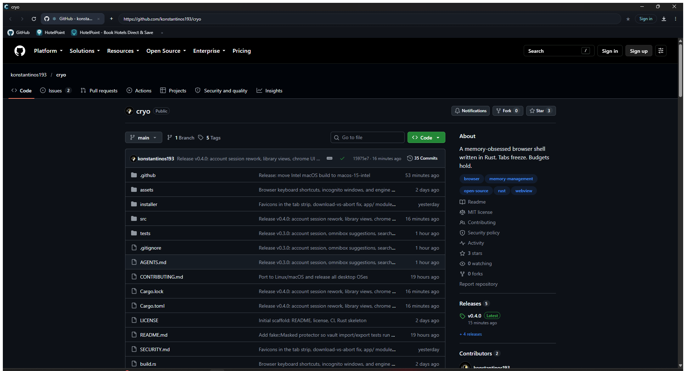
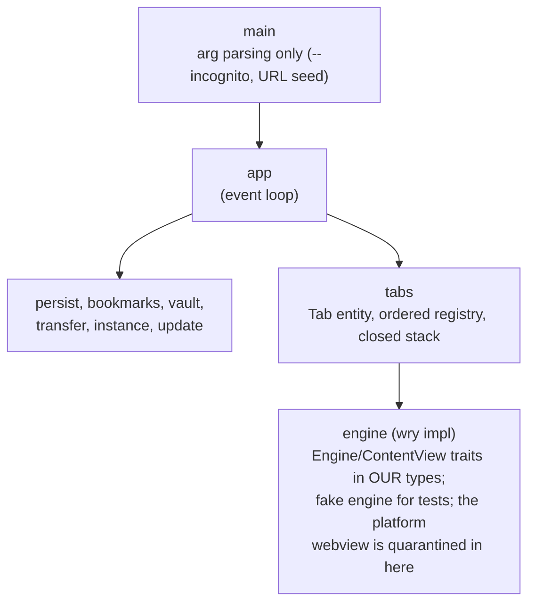

<p align="center">
  
</p>

<h1 align="center">cryo</h1>

<p align="center">
  <a href="https://github.com/konstantinos193/cryo/actions/workflows/ci.yml"></a>
  <a href="https://github.com/konstantinos193/cryo/releases/latest"></a>
  <a href="LICENSE"></a>
  <a href="#status"></a>
</p>

<p align="center"><b>A memory-obsessed browser shell in Rust. Tabs freeze. Budgets hold.</b></p>

<p align="center">
  
</p>

Your browser's plan for 40 open tabs is to let them eat until something dies.
cryo's plan is a freezer.

cryo is a browser shell with one job: decide which tabs deserve to stay alive.
It ships no HTML parser. The engine is plumbing (WebView2 on Windows, WebKitGTK
on Linux, WKWebView on macOS), swappable behind traits, and the engineering goes
into the policy layer instead: lifecycle, budgets, accounting. A tab that stops
earning its RAM gets frozen. cryo takes a snapshot and destroys the webview.
Click the tab and it reloads the saved URL with its zoom and mute settings.
Discard drops the view without keeping that snapshot.

Destroying a webview releases its document, but does not guarantee that its
renderer process exits. WebView2 can share renderers between views; memory
reclamation can be delayed, and browser/GPU overhead remains. cryo measures
process memory before and after freezing rather than treating a tab's reported
process memory as guaranteed savings.

## Status

The shell works and tabs freeze, discard and restore on Windows, Linux and
macOS. Process memory is measured and eligible background tabs freeze
automatically under a configurable private-memory budget — WebView2's
environment on Windows, the WebKit child-process tree on Linux and macOS.
Shared renderers are not billed to individual tabs. The enforcement loop is
live-verified on Windows; the Unix accounting adapters are implemented but
not yet exercised against real WebKit processes.

What exists today:

- Freeze, discard, restore: `Ctrl+Shift+F` (or the button on the tab) snapshots
  a tab and drops its webview; activating it rebuilds the surface through the
  same path the closed-tab stack uses.
- One ordered tab registry: reopen closed (`Ctrl+Shift+T`, restores strip
  position), duplicate, mute, reorder, middle-click to close.
- Speed dial in both places browsers put it: a bar under the toolbar and tiles
  on the new-tab page, both fed by one `/dials` list on the internal protocol.
- Omnibox memory: typed input and visits are remembered and suggested, bounded
  at 5000 entries. Incognito windows keep none, and none of it is fetchable.
  Any origin could read a `/history` endpoint, so there isn't one.
- Bookmarks: `Ctrl+D` keeps the page, a bar under the toolbar shows the kept
  pages, `Ctrl+Shift+O` opens the library panel (kept pages, saved passwords,
  import, export).
- A password vault sealed by DPAPI on Windows, the OS keychain elsewhere. Copy
  the file to another account and it decrypts to nothing.
- A download shelf (`Ctrl+J`): pause, resume, retry, cancel, show in folder,
  drag files straight out of the shelf.
- Import and export for other browsers' formats. Foreign bytes become drafts
  here, then pass through the same constructors as homegrown data.
  `edge-import/` holds a real Edge profile as the fixture.
- Incognito windows as real InPrivate sibling processes (`--incognito`), not a
  cosmetic flag.
- On Windows, external links reach the running window over a named pipe and
  become tabs instead of a second browser.
- Self-update on Windows: check the release feed, verify the checksum, run the
  installer.
- The shell UI itself (chrome strip, new-tab page, settings) is rendered by the
  same engine it manages, served from `http://cryo.localhost`.

## Keyboard shortcuts

Two input paths (WebView2's `AcceleratorKeyPressed` while a view has focus,
tao's `KeyboardInput` otherwise) feed one `key_command()` mapping, so keys
behave the same whether the page or the chrome owns focus.

| Keys | Action |
|---|---|
| `Ctrl+T` / `Ctrl+W` / `Ctrl+F4` | New tab / close tab |
| `Ctrl+Shift+T` | Reopen closed tab (bounded stack, restores strip position) |
| `Ctrl+Tab` / `Ctrl+PgDn` · `Ctrl+Shift+Tab` / `Ctrl+PgUp` | Next / previous tab |
| `Ctrl+1..8` / `Ctrl+9` | Jump to tab N / last tab |
| `Ctrl+Shift+PgUp` / `PgDn` | Move tab left / right |
| `Ctrl+Shift+Home` / `End` | Move tab to start / end |
| `Ctrl+Shift+K` | Duplicate tab |
| `Ctrl+M` | Mute / unmute tab |
| `Ctrl+Shift+F` | Freeze tab: drops the view, keeps a snapshot. Click to restore |
| `Ctrl+D` / `Ctrl+Shift+O` | Keep page / open the library |
| `Ctrl+J` | Download shelf |
| `Ctrl+N` / `Ctrl+Shift+N` | New window / new incognito window |
| `Ctrl+Shift+W` / `Ctrl+Shift+Q` / `Alt+F4` | Close window / quit |
| `Ctrl+L` / `Alt+D` / `Ctrl+K` / `Ctrl+E` | Focus address bar |
| `F6` / `Ctrl+F6` | Cycle focus address bar ↔ page / jump to page |
| `Alt+Enter` / `Alt+Shift+Enter` | Open address-bar input in new foreground / background tab |
| `Ctrl+Enter` | `www.<word>.com` canonize + open |
| `Ctrl+Shift+Enter` | Open input in a new window |
| `Ctrl+Shift+L` | Paste-and-go (Edge) |
| `Alt+←` / `Alt+→` | Back / forward |
| `F5` / `Ctrl+R` | Reload |
| `Ctrl+F5` / `Ctrl+Shift+R` / `Shift+F5` | Hard reload (DevTools-protocol cache bypass) |
| `Esc` | Stop loading (still reaches the page for dialogs and menus) |
| `Ctrl+P` / `Ctrl+S` / `Ctrl+O` | Print / save-as / open file into `file://` |
| `Ctrl+U` | `view-source:` in a new tab |
| `Ctrl+=`/`+` / `Ctrl+-` / `Ctrl+0` | Zoom in / out / reset (×1.25 steps, 25 to 500%) |
| `Ctrl+Shift+S` | Screenshot into `Pictures\cryo\shot-*.png` |
| `Ctrl+Shift+Del` | Clear all browsing data for the profile |
| `F11` | Borderless fullscreen |
| `F12` / `Ctrl+Shift+I` / `J` / `C` | DevTools |
| `Alt+Home` | Home (new-tab page) |

Mouse: `target=_blank`, ctrl/shift/middle-click and `window.open` are captured
via `NewWindowRequested`, denied as popups, and reopened as foreground tabs.
Middle-click a tab to close it.

## Architecture



Dependencies point one way: policy never imports plumbing. `wry` types exist
only inside `engine/`, `tao` types only in `app`/`lib`. Per-tab state is one
`Tab` struct in one ordered `Vec`, not a `HashMap<TabId, _>` farm. Serde never
touches a domain type; snapshots and wire formats are versioned DTOs at the
boundary.

The enforceable version of this is [AGENTS.md](AGENTS.md): module boundaries,
banned names (`util`, `manager`, `helper`), hydration rules, one error enum
per module. It is the only thing standing between this codebase and spaghetti,
and it gets checked in review.

## Install and run

Prebuilt binaries for Windows, Linux and macOS are on the
[releases page](https://github.com/konstantinos193/cryo/releases).

Requirements: Windows 10/11 (WebView2 ships with the OS), a Linux with
WebKitGTK installed (wry's appetite, not ours), or macOS (WKWebView comes
free).

### Windows will warn you

The installer is unsigned, so SmartScreen opens with "Windows protected
your PC" the first time you run it. That is not a verdict on the file.
It means the binary carries no code-signing certificate and no download
reputation yet — every new unsigned installer gets the same greeting,
and a brand-new signature gets a politer version of it.

Two things worth more than the dialog:

1. Take `cryo-setup.exe` from the
   [releases page](https://github.com/konstantinos193/cryo/releases) and
   nowhere else.
2. Check the bytes against the hash the build published:

   ```powershell
   (Get-FileHash .\cryo-setup.exe -Algorithm SHA256).Hash.ToLowerInvariant()
   ```

   Compare it with the `sha256` field in `latest.json` on the same
   release. That file is written by the GitHub Actions run that built the
   installer — the same hash the updater verifies before it installs
   anything. A mismatch means the file is not what CI produced, and the
   warning stops being theoretical.

Matching hash, then **More info → Run anyway**.

The pipeline signs both `cryo.exe` and `cryo-setup.exe` the moment a real
code-signing certificate lands in repo secrets; no workflow change needed
(see [CONTRIBUTING.md](CONTRIBUTING.md)). A self-signed one proves
integrity and clears nothing — SmartScreen trades in reputation, not
homework.

Or build it. Rust stable:

```powershell
cargo run                      # normal window
cargo run -- --incognito       # private window, in-memory profile
cargo run -- https://site.com  # seed the first tab with an address
cargo run --release            # no console window
```

CI gates: `cargo fmt`, `cargo clippy -D warnings`, `cargo build`, `cargo test`.
`.devin/tools/keys.ps1` drives a running window with SendKeys for manual
shortcut testing (`keys.ps1 -Keys "^t"` = Ctrl+T).

## Memory budget

The default budget is 1024 MiB of engine private committed memory — the
WebView2 environment on Windows, the WebKit child-process tree on Linux and
macOS — including browser/GPU process overhead. It excludes Cryo's host
process and GPU device allocations. Set a positive integer before launch to
change it:

```powershell
$env:CRYO_MEMORY_BUDGET_MIB = "768"
cargo run
```

This is a soft budget, not an OS-enforced RAM ceiling. Every five seconds Cryo
samples memory. Two over-budget samples start enforcement; it stops at 90% of
the budget. Each decision freezes at most one least-recently-used eligible tab,
then waits 15 seconds and remeasures. If less than 1 MiB was reclaimed, further
freezing backs off for 60 seconds.

Foreground tabs, loading pages, active/paused downloads, audio (including unknown
audio state), pending prompts, and recently used/new/restored views are protected.
A background tab must remain unfocused for two minutes before automatic freezing.
Top-level user input and camera/microphone permission requests conservatively
protect that view until it is manually frozen, discarded or closed. This does
not detect every kind of unsaved application state, including embedded-frame
editors. Non-HTTP(S) pages are excluded from automatic freezing.

The budget can remain exceeded when all remaining tabs are protected or shared
engine overhead cannot be reclaimed. Manual freeze and restore remain available;
there is no longer a 24-live-view cap.

## Roadmap

- [x] Phase 0: shell. Window, tabs, navigation, shortcuts, incognito.
- [x] Phase 1: tab lifecycle. Freeze, discard, restore.
- [x] The parts a browser needs anyway: bookmarks, vault, downloads, history,
  import/export, self-update.
- [ ] Phase 2: finish per-tab attribution and verify the Unix memory
  accounting adapters. Measured budgets are implemented on all three
  platforms and live-verified on Windows.
- [ ] Phase 3: memory dashboard (the real `Shift+Esc`).
- [ ] Phase 4: a WebExtensions (MV3) surface.
- [ ] Phase 5: evaluate Servo as a second engine backend. If it earns the slot.

Known gaps by design: find-in-page, a browsable history surface (the store
exists, the page doesn't), tab search overlay, a task manager. They go in
issues, not in half-built code.

## Contributing

PRs only, `main` is protected. [CONTRIBUTING.md](CONTRIBUTING.md) has the
ground rules and [AGENTS.md](AGENTS.md) has the anti-spaghetti laws. Review
enforces both; clippy enforces the rest.

## License

MIT, see [LICENSE](LICENSE).
